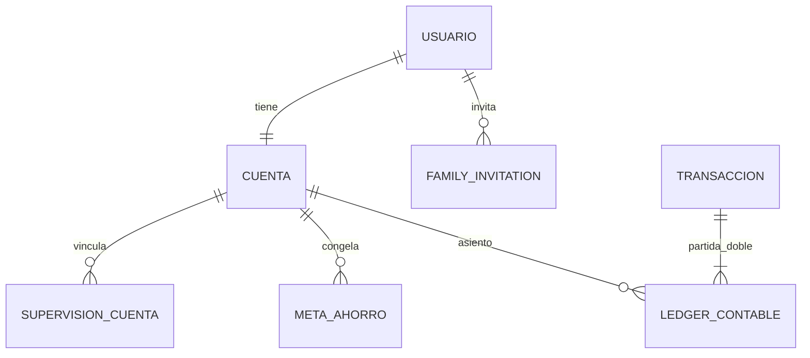

# BeHu

Plataforma Fintech de cuentas transaccionales, control parental e IA predictiva (BeHu Mini) para el mercado colombiano — Jäger Group (Pontificia Universidad Javeriana).

**v2.0.0** es el neobanco familiar sandbox: el mismo ledger de partida doble, ahora con invitación por consentimiento, regla 50/30/20, bloqueo de tarjeta Junior y BeHu Mini por reglas. No hay ACH ni redes de tarjetas reales. API y PWA salen juntas en Vercel Services; Postgres va en Neon y los hábitos en MongoDB Atlas.

## Arquitectura

```
app/core        config, JWT, Postgres, Mongo, arranque Vercel
app/models      usuario, cuenta, ledger, supervision, family_invitation, meta
app/services    ledger, invitaciones, neobanco, BeHu Mini, score, academia
app/api/v1      contratos HTTP
frontend        PWA Next.js, dark mode
```



La mesada, el gasto, el ingreso simulado y el abono a meta pasan por `transferir()`: un débito y un crédito en la misma transacción. El Junior no ve asientos `es_transferencia_global`.

## Design tokens

Fondos `#090D16`, `#0F1422`, `#111726`, `#161E31`, `#1A2338`. Bordes `#1E293B` y `#334155`. Texto `#F8FAFC`, `#94A3B8`, `#64748B`. Acentos azul `#3B82F6`, éxito `#10B981`, peligro `#F43F5E`, aviso `#F59E0B`. Botón primario blanco con texto `#090D16`. Radios 8, 12 y 16 px. Transición `0.15s cubic-bezier(0.16, 1, 0.3, 1)`.

## BeHu Mini

No hay LLM. El motor lee saldo líquido, saldo congelado, límites y la regla 50/30/20. Marca gasto hormiga con 3 compras pequeñas de comida u ocio en 48 horas. Si el Junior fuerza una compra, el Score baja y el Senior recibe la alerta en `GET /api/v1/ai/parental-alerts`. El Senior recibe un fondo de emergencia de 3 a 6 meses y la pista de CDT o fondo conservador. El Junior recibe un abono sugerido para la meta activa.

## Stack

- Python 3.11+
- FastAPI + Pydantic v2
- SQLite (sandbox local) o PostgreSQL (SQLAlchemy 2 async)
- MongoDB (Motor) — hábitos y recomendaciones de IA (contrato)
- JWT + bcrypt

Documentación:

- [Arquitectura](docs/architecture.md)
- [Esquema de datos](docs/database_schema.md)
- [Changelog](CHANGELOG.md)
- [Despliegue v1.0.0](docs/deployment.md)

## Requisitos

- Python 3.11 o superior
- SQLite (incluido) para el sandbox local; PostgreSQL 15+ es opcional
- MongoDB 6+ opcional; el healthcheck no lo exige

## Configuración del entorno

```bash
python3.11 -m venv .venv
source .venv/bin/activate
pip install -r requirements.txt
cp .env.example .env
```

`.env.example` apunta a `sqlite+aiosqlite:///./behu_sandbox.db`. No commitees `.env`.

## Arranque local y seed

```bash
source .venv/bin/activate
python scripts/seed_sandbox.py
uvicorn app.main:app --reload --host 0.0.0.0 --port 8000
```

- Health: [http://127.0.0.1:8000/health](http://127.0.0.1:8000/health)
- Swagger: [http://127.0.0.1:8000/docs](http://127.0.0.1:8000/docs)

Usuarios del sandbox:

| Rol | Email | Password | Saldo |
| --- | --- | --- | --- |
| SENIOR | `senior@behu.test` | `BeHuSenior1!` | 1.000.000 COP |
| JUNIOR | `junior@behu.test` | `BeHuJunior1!` | 0 COP (vinculado) |

En `/docs`: `POST /api/v1/auth/login` → copiar `access_token` → botón **Authorize** → `Bearer <token>`.

Prueba sugerida: con el token Senior, `GET /api/v1/accounts/me`, `GET /api/v1/supervision/juniors` y `POST /api/v1/transfers/budget`. Con el token Junior, `GET /api/v1/accounts/me` (sin transferencias globales).

## Sprint 2 (hábitos, metas, Docker, frontend)

Backend local (recrea la base si vienes del Sprint 1):

```bash
rm -f behu_sandbox.db
python scripts/seed_sandbox.py
uvicorn app.main:app --reload --host 0.0.0.0 --port 8000
```

Frontend:

```bash
cd frontend
npm install
cp .env.example .env.local
npm run dev
```

Abre [http://127.0.0.1:3000](http://127.0.0.1:3000). Docker:

```bash
docker compose up --build
docker compose exec backend python scripts/seed_sandbox.py
```

## Pruebas

```bash
source .venv/bin/activate
pip install -r requirements.txt
pytest -q
```

## Release v2.0.0

La línea publicada es `main`. Root Directory de Vercel en `.`. Variables en **All Services**: `DATABASE_URL` de Neon, `AUTO_SEED_SANDBOX=true`, `JWT_SECRET` y `MONGODB_URI` de Atlas. `NEXT_PUBLIC_API_URL` vacía. El detalle está en [docs/deployment.md](docs/deployment.md). Tras el deploy, `GET /api/health` debe mostrar `dialect: postgresql`.

## Despliegue objetivo

| Pieza | Destino |
| --- | --- |
| API y PWA | Vercel Services (mismo dominio) |
| Postgres | Neon o Supabase |
| Hábitos e IA | MongoDB Atlas |
| KYC | AWS S3 (local si no hay llaves) |
