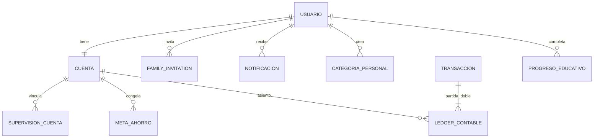

# BeHu

Neobanco familiar sandbox de **Behavior & Human Finance** (Jäger Group, Pontificia Universidad Javeriana). Ordena saldo, metas, control parental y educación en una PWA. No mueve dinero real: no hay ACH ni redes de tarjetas.

**v5.0.0**

## Propuesta

Una familia ve el mismo ledger. El Senior invita, pone límites y lee alertas. El Junior gasta dentro de esos topes, aparta metas y practica con BeHu Mini. Cada movimiento es una partida doble. El comprobante lleva un sello HMAC y el respaldo de la cuenta sale cifrado.

## Arquitectura

| Capa | Pieza |
| --- | --- |
| PWA | Next.js 15, React 19, tema claro y oscuro |
| API | FastAPI en Vercel (`app.main:app`), prefijo `/api/v1` |
| Ledger | Neon PostgreSQL, SQLAlchemy 2 async |
| Hábitos y backup híbrido | MongoDB Atlas, con JSON local si Atlas no responde |
| Objetos | AWS S3 cuando hay `AWS_ACCESS_KEY_ID`, `AWS_SECRET_ACCESS_KEY` y `AWS_S3_BUCKET` o `AWS_S3_KYC_BUCKET` |
| Cifrado | AES-256-GCM. La clave deriva de `JWT_SECRET` y, si existe, `AWS_KMS_KEY_ID` |



`transferir()` escribe el débito, el crédito y el sello HMAC en la misma operación. El Junior no ve asientos `es_transferencia_global`.

## BeHu Mini

No hay LLM. `POST /api/v1/ai/consult` acepta `message`, `question` o `pregunta` y devuelve `reply`, `response`, `insights` y `suggested_actions`, además del arreglo `recomendaciones`. La respuesta usa saldo, moneda, metas, regla 50/30/20 y, si el rol es Senior, el estado de los Juniors. El chat apaga el indicador de escritura en `finally`.

## Academia y pausas

Aprende ofrece rutas con ejemplos, flashcards, un reto de 20 segundos con racha y las insignias del quiz. La tercera compra de un Junior en tres horas, o un monto superior a 1,5 veces su ticket medio, responde `409` con `PATRON_ANOMALO` y deja una alerta en `GET /api/v1/notifications`.

## Endpoints

| Método | Ruta | Uso |
| --- | --- | --- |
| POST | `/api/v1/auth/register` `/login` | Sesión |
| PATCH | `/api/v1/users/me` | Perfil, moneda, ingreso |
| GET | `/api/v1/accounts/me` | Saldo, movimientos, llave `@usuario.behu` |
| POST | `/api/v1/transactions` | Gasto o ingreso. `redondear_ahorro` abona el vuelto a la meta |
| GET | `/api/v1/transactions/{id}/receipt` | Débito, crédito y sello |
| POST | `/api/v1/transfers/budget` `/transfers/key` | Mesada o envío por llave |
| GET | `/api/v1/notifications` | Campana |
| PATCH | `/api/v1/notifications/{id}/read` | Marcar leída |
| GET POST | `/api/v1/categories` | 18 del sistema y las propias |
| POST | `/api/v1/ai/consult` | BeHu Mini |
| GET | `/api/v1/ai/parental-alerts` | Alertas del Senior |
| POST | `/api/v1/education/modules/{id}/complete` | Quiz e insignia |
| POST | `/api/v1/kyc/document` | Documento cifrado |
| POST | `/api/v1/system/backup` | Snapshot AES-256-GCM y SHA-256 |
| GET | `/api/health` | Salud sin abrir la base |

## Local

```bash
python3.11 -m venv .venv
source .venv/bin/activate
pip install -r requirements.txt
cp .env.example .env
python scripts/seed_sandbox.py
uvicorn app.main:app --reload --host 0.0.0.0 --port 8000
```

```bash
cd frontend
npm install
npm run dev
```

| Rol | Email | Password |
| --- | --- | --- |
| SENIOR | `senior@behu.test` | `BeHuSenior1!` |
| JUNIOR | `junior@behu.test` | `BeHuJunior1!` |

```bash
pytest -q
cd frontend && npm run build
```

## Despliegue

Root Directory de Vercel en `.`. Variables en **All Services**: `DATABASE_URL` de Neon, `AUTO_SEED_SANDBOX=true`, `JWT_SECRET`, `MONGODB_URI`. `NEXT_PUBLIC_API_URL` vacía. S3 y KMS son opcionales; sin ellos el backup queda híbrido y el cifrado sigue saliendo de `JWT_SECRET`. Tras el deploy, `GET /api/health` debe mostrar `dialect: postgresql`.

Detalle de rutas y variables: [docs/deployment.md](docs/deployment.md). Historial: [CHANGELOG.md](CHANGELOG.md).
