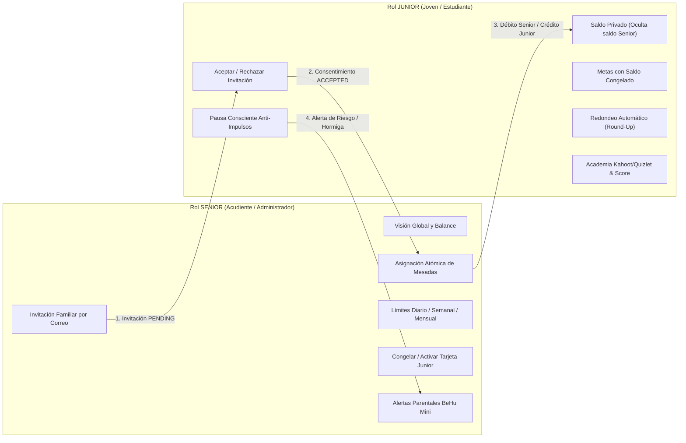
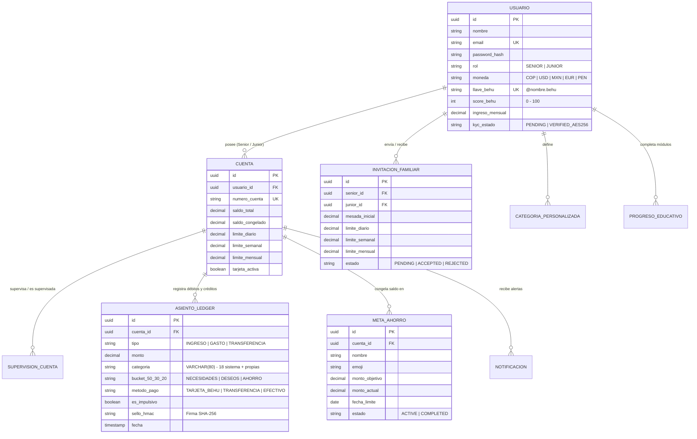

<div align="center">

# BeHu
### Ecosistema Neobanco Familiar Colaborativo con Inteligencia Artificial Simbólica

[](https://github.com/ch3cho33/Proyecto_BeHu)
[](https://proyecto-be-hu.vercel.app)
[](https://fastapi.tiangolo.com/)
[](https://nextjs.org/)
[](https://neon.tech/)
[](https://docs.pytest.org/)

**Desarrollado por Jäger Group · Pontificia Universidad Javeriana**  
*Fundamentos de Ingeniería de Software — MVP en Producción (`https://proyecto-be-hu.vercel.app`)*

</div>

---

## 1. Visión, Esencia y Propuesta de Valor

**BeHu** (*Behavior & Human Finance*) es una plataforma fintech de **finanzas personales y familiares colaborativas** diseñada como una *Progressive Web App* (PWA) instalable. Su propósito es sustituir los extractos bancarios pasivos y las hojas de cálculo manuales por una experiencia proactiva que **transforma gastos cotidianos en hábitos financieros saludables**.

> **Nota de Alcance Sandbox:** BeHu opera como un entorno Neobanco Sandbox completo sobre un motor contable de partida doble real (`Ledger ACID`). No procesa dinero fiduciario real ni se conecta a redes interbancarias ACH/SWIFT, permitiendo experimentar con total seguridad flujos financieros familiares, control parental, redondeo automático, llaves `@usuario.behu` y educación gamificada.

### ¿Qué hace único a BeHu?

| Dimensión | Métodos Caseros (Efectivo / Excel) | Banca Tradicional / Neobancos | **Ecosistema BeHu v5.0** |
| :--- | :--- | :--- | :--- |
| **Rigor Contable** | Manual y propenso a errores humanos | Transaccional básico | **Ledger de Partida Doble ACID + Sello HMAC** |
| **Control Parental** | Inexistente o basado en efectivo | Sin jerarquía familiar nativa | **Cuentas Senior/Junior con consentimiento y topes** |
| **Prevención de Impulsos** | Ninguna | Solo notifica después de cobrar | **Pausa Consciente (*Nudge Theory*) + Alertas IA** |
| **Protección de Metas** | Alcancía física | Bolsillos sin bloqueo efectivo | **Saldo Congelado (`frozenInGoals`) + Round-Up** |
| **Educación Financiera** | Nula | Blogs estáticos externos | **BeHu Mini IA + Academia Kahoot & Quizlet** |

---

## 2. El Problema Socioeconómico y Nuestra Solución

En Colombia y Latinoamérica, los jóvenes acceden cada vez más temprano al crédito y al consumo digital sin contar con herramientas prácticas de educación financiera:

* **37.7%** de los créditos otorgados en Colombia se concentran en menores de 35 años *(DataCrédito Experian)*.
* **> 50%** de los jóvenes no sabe elaborar un presupuesto ni planificar metas a mediano/largo plazo.
* **6 de cada 10** jóvenes admiten no comprender los productos financieros que consumen *(Forbes Colombia)*.
* **1 de cada 4** mantiene un hábito real de ahorro constante, exponiéndose a "deudas silenciosas" y compras impulsivas.

**La Solución BeHu:** Un ecosistema jerárquico donde el **Acudiente (Senior)** asigna recursos y límites dinámicos con trazabilidad completa, mientras el **Joven (Junior)** opera su propia cuenta con autonomía segura, ahorro blindado, alertas ante patrones anómalos y acompañamiento pedagógico en tiempo real.

---

## 3. Roles Jerárquicos y Flujos de Usuario



---

##  4. Stack Tecnológico Detallado

BeHu está diseñado bajo una **arquitectura orientada a servicios modulares desacoplados** y **persistencia políglota** (SQL relacional ACID para el libro mayor contable + NoSQL documental para hábitos y telemetría IA), desplegado en infraestructura Serverless de alta disponibilidad.

```
### 

| Capa | Tecnología | Propósito en BeHu |
| :--- | :--- | :--- |
| **Frontend & PWA** | Next.js 15, React 19, TypeScript, Tailwind CSS | Interfaz responsive con Floating Dock, gráficos SVG nativos, tema dual y manifiesto PWA instalable. |
| **Backend API** | Python 3.12, FastAPI, Pydantic v2 | API RESTful asíncrona (`/api/v1`), validación estricta de contratos y microservicios por dominio. |
| **Base de Datos SQL** | Neon PostgreSQL + SQLAlchemy 2 Async | Garantía ACID para usuarios, cuentas, asientos de partida doble, metas e invitaciones familiares. |
| **Base de Datos NoSQL** | MongoDB Atlas + Motor | Almacenamiento flexible de conversaciones de BeHu Mini, patrones de hábitos y respaldo híbrido. |
| **Criptografía y Cloud** | `cryptography` (AES-256-GCM), `boto3` (AWS S3), HMAC | Cifrado de documentos KYC, backups firmados SHA-256 y sellos de integridad en recibos. |
| **QA y CI/CD** | Pytest, AsyncIO, GitFlow, Vercel | Suite automatizada de 9 pruebas de integración y despliegue continuo desde `main`. |

---

## 5. Modelo de Datos (Entidad–Relación & NoSQL)

El esquema relacional en **Neon PostgreSQL** cuenta con migraciones idempotentes automáticas (`ALTER TABLE` seguro en arranque) y modela la contabilidad de partida doble junto con la jerarquía familiar:



### Colecciones Documentales en MongoDB Atlas (`behu_ai`)
* `ai_conversations`: Historial contextualizado de consultas y diagnósticos generados por BeHu Mini.
* `behavioral_events`: Telemetría de gastos hormiga, compras consecutivas y patrones anómalos.
* `encrypted_backups`: Almacén híbrido de snapshots cifrados en AES-256-GCM con firma SHA-256.

---

## 6. Motor Inteligente: BeHu Mini IA (Sistema Experto)

A diferencia de chatbots genéricos propensos a alucinaciones o latencia externa, **BeHu Mini** implementa un **Sistema Experto Simbólico Sensible al Contexto** (`app/services/behu_mini_ai.py`) que consulta en vivo el estado del usuario en Neon PostgreSQL:

1. **Detección de Patrones Nocivos y Riesgo:**
   * **Gastos Hormiga:** Identifica $\ge 3$ compras pequeñas en categorías de comida u ocio dentro de una ventana de 48 horas.
   * **Gastos No Pertinentes / Viciosos:** Analizador léxico que detecta conceptos de riesgo (`apuesta`, `casino`, `bet`, `licor`, `cerveza`, `bar`, `discoteca`, `vape`, `cigarro`, `videojuegos`, `skins`, `recarga juego`) y dispara una alerta prioritaria (`severity: "high"`) al Senior con alternativas de ahorro.
   * **Patrón Anómalo en Junior (`409 PATRON_ANOMALO`):** Intercepta la 3.ª compra en menos de 3 horas o gastos superiores a $1.5\times$ el ticket promedio histórico, activando el **Modal de Pausa Consciente**.
2. **Asesoría Diferenciada por Rol:**
   * **Para Senior:** Calcula el fondo de emergencia ideal (3 meses de gastos reales), el excedente invertible hoy y proyecta rendimientos en CDTs (al 1% mensual) a 3, 6 y 12 meses.
   * **Para Junior:** Calcula la capacidad diaria segura hasta fin de mes (`saldo_disponible / días_restantes`), sugiere retos de ahorro sobre metas activas y cuantifica cuánto capital recuperaría eliminando gastos hormiga.

---

## 7. Seguridad Bancaria, Criptografía y Respaldo en Nube

* **Autenticación y Control de Acceso (RBAC):** Tokens JWT firmados (`HS256`), contraseñas hasheadas con Argon2/Bcrypt y aislamiento estricto de rutas (un usuario `JUNIOR` recibe `HTTP 403` si intenta acceder a endpoints de supervisión familiar).
* **Sello de Integridad en Comprobantes (`HMAC-SHA256`):** Cada asiento contable en el Ledger incluye una firma criptográfica verificable visible en su comprobante digital.
* **Cifrado de Documentos KYC (`AES-256-GCM`):** Los metadatos y documentos cargados en `POST /api/v1/kyc/document` se cifran en reposo mediante derivación de clave segura compatible con AWS KMS Envelope Encryption.
* **Backup Cifrado en la Nube (`POST /api/v1/system/backup`):** Genera un snapshot completo de cuentas, ledger, metas e insignias cifrado con **AES-256-GCM** y firmado con **SHA-256**, subiéndolo a **Amazon AWS S3** (cuando hay credenciales IAM) o al almacén híbrido con descarga directa desde Ajustes.

---

## 8. Catálogo de Endpoints REST API (`/api/v1`)

| Dominio | Método | Endpoint | Descripción |
| :--- | :---: | :--- | :--- |
| **Sistema** | `GET` | `/api/health` & `/api/v1/health/db` | Estado del servicio, dialecto SQL activo y conectividad a Neon. |
| **Auth** | `POST` | `/api/v1/auth/register` & `/login` | Registro con rol/moneda y autenticación JWT. |
| **Usuarios** | `GET` / `PATCH` | `/api/v1/users/me` | Consulta y actualización de perfil, moneda e ingreso mensual. |
| **Ledger** | `GET` / `POST` | `/api/v1/transactions` | Listado y registro de gastos/ingresos con `redondear_ahorro` y `forzar_confirmacion`. |
| **Neobanco** | `POST` | `/api/v1/transfers/key` | Transferencia instantánea entre cuentas usando `@llave.behu`. |
| **50/30/20** | `GET` | `/api/v1/budgets/50-30-20` | Distribución dinámica de Necesidades (50%), Deseos (30%) y Ahorro (20%). |
| **Categorías** | `GET` / `POST` | `/api/v1/categories` | 18 categorías predefinidas del sistema + creación de categorías personalizadas. |
| **Metas** | `GET` / `POST` | `/api/v1/goals` & `/{id}/contribute` | Creación de metas y abono con congelamiento inmediato de saldo. |
| **Familia** | `POST` | `/api/v1/supervision/invite` | Envío de invitación familiar (`PENDING`) o creación asistida de Junior. |
| **Consentimiento** | `GET` / `POST` | `/api/v1/supervision/invitations` | Consulta y aceptación/rechazo de vínculo familiar por el Junior. |
| **Control** | `PATCH` / `GET` | `/api/v1/supervision/juniors/{id}/...` | Edición de límites, bloqueo/activación de tarjeta y auditoría de actividad. |
| **BeHu Mini IA** | `POST` / `GET` | `/api/v1/ai/consult` & `/parental-alerts` | Chat contextualizado y alertas de gastos hormiga/no pertinentes. |
| **Alertas** | `GET` / `PATCH` | `/api/v1/notifications` | Campana de notificaciones in-app en tiempo real. |
| **Academia** | `GET` / `POST` | `/api/v1/education/modules` | Módulos interactivos, quizzes cronometrados e insignias de Score. |
| **Seguridad** | `POST` | `/api/v1/kyc/document` & `/system/backup` | Carga KYC cifrada y generación de backup AES-256-GCM / S3. |

---

## 9. Trazabilidad: Sprints e Historias de Usuario

El desarrollo siguió la metodología **GitFlow** (`main`, `develop`, `feature/*`) organizada por Milestones en GitHub:

| Sprint / Milestone | Historias de Usuario | Alcance Técnico Entregado | Estado |
| :--- | :--- | :--- | :---: |
| **Sprint 1** | `HU-01` a `HU-04` | Autenticación Senior/Junior, vinculación familiar con consentimiento, asignación atómica de mesadas y topes de consumo. | ✅ |
| **Sprint 2** | `HU-05` a `HU-07` | Motor simbólico BeHu Mini IA, metas de ahorro con saldo congelado e intercepción de compras impulsivas. | ✅ |
| **Sprint 3** | `HU-08` y `HU-09` | Score dinámico de salud financiera (0–100), módulos de Micro-Learning con insignias y CI/CD en Vercel. | ✅ |
| **Releases v2–v5** | *Evolución Neobanco* | Landing pública, Split-Auth, Tarjeta Virtual, Llaves `@behu`, Redondeo Round-Up, Tema Claro/Oscuro, Academia Kahoot/Quizlet y Backup AES-256/S3. | ✅ |

---

## 10. Instalación Local, Pruebas y Despliegue en Vercel

### Ejecución Local

```bash
# 1. Clonar el repositorio
git clone https://github.com/ch3cho33/Proyecto_BeHu.git
cd Proyecto_BeHu

# 2. Backend FastAPI (Python 3.12+)
python -m venv .venv
source .venv/bin/activate
pip install -r requirements.txt
uvicorn app.main:app --reload --port 8000

# 3. Frontend Next.js (en otra terminal)
cd frontend
npm install
npm run dev
```

### Variables de Entorno (Producción Vercel)

```env
DATABASE_URL=postgresql+asyncpg://<user>:<password>@<neon-host>/neondb?sslmode=require
MONGODB_URI=mongodb+srv://<user>:<password>@<cluster>.mongodb.net/behu_ai?retryWrites=true&w=majority
JWT_SECRET=<clave-secreta-robusta>
AUTO_SEED_SANDBOX=true
ENVIRONMENT=production
# Opcionales para bucket AWS S3 real:
AWS_ACCESS_KEY_ID=<opcional>
AWS_SECRET_ACCESS_KEY=<opcional>
AWS_S3_BUCKET=<opcional>
```

### Cuentas Demo Sandbox Precargadas
* **Perfil Senior (Acudiente):** `senior@behu.test` / `BeHuSenior1!`
* **Perfil Junior (Dependiente):** `junior@behu.test` / `BeHuJunior1!`

---

## 11. Equipo de Ingeniería (Jäger Group)

Proyecto desarrollado para la asignatura **Fundamentos de Ingeniería de Software** — **Pontificia Universidad Javeriana**:

* **Sergio Pulido** — *DevOps Engineer & Scrum Master* (Orquestación de repositorios, GitFlow, Sprints y CI/CD).
* **Esteban Cantillo** — *Software & Database Architect* (Persistencia políglota ACID en Neon PostgreSQL y NoSQL en MongoDB).
* **Juan David Botero** — *Backend & IA Lead* (Arquitectura FastAPI, Ledger de partida doble y motor BeHu Mini IA).
* **Santiago Báez Parra** — *Frontend & UX/UI Director* (PWA en Next.js 15, Design System dual y visualización de datos).


