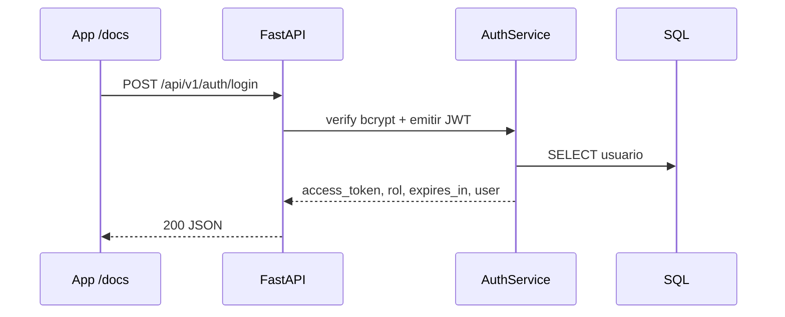
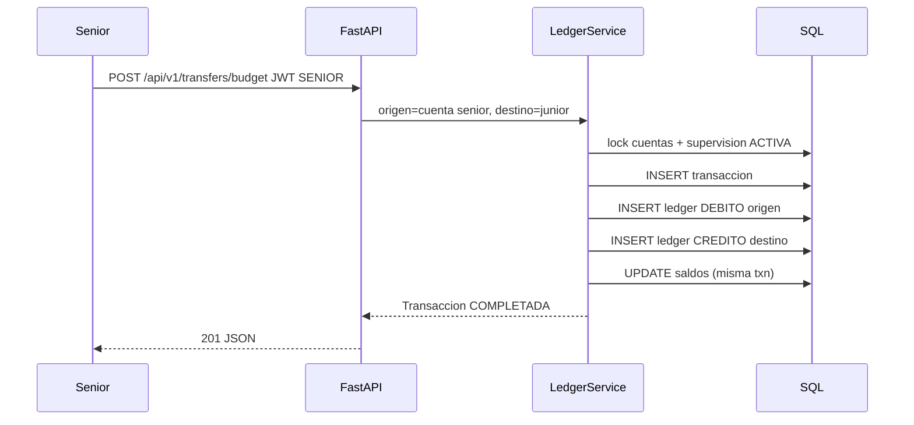
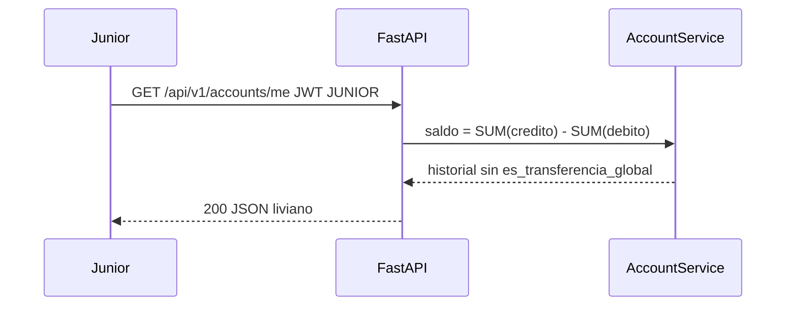

# Arquitectura BeHu — Sprint 1

BeHu es un banco Fintech para el mercado colombiano (Jäger Group / Pontificia Universidad Javeriana). El canal principal de consumo es **aplicación móvil (iOS / Android) y PWA Next.js**. El backend FastAPI es un API REST **stateless**: cada petición se autentica con JWT; no hay sesiones de servidor ni cookies de autenticación.

## 1. Componentes

| Capa | Tecnología | Responsabilidad |
| --- | --- | --- |
| Clientes | iOS / Android / PWA (Next.js en Vercel) | UI, almacenamiento seguro del JWT, claims `rol` |
| API | FastAPI (Python 3.11+), Railway | Autenticación, cuentas, supervisión parental, ledger |
| Relacional | PostgreSQL | Entidades ACID: usuario, cuenta, supervisión, transacción, ledger |
| Documental | MongoDB | Hábitos no estructurados e historial de recomendaciones de IA |
| Objetos | AWS S3 | Documentos KYC (contrato; no implementado en Fase 1) |
| Llaves | AWS KMS | Cifrado de secretos y PII (contrato; no implementado en Fase 1) |

Separación de capas del backend:

```
app/
  core/       # config, seguridad JWT, conexiones DB
  models/     # SQLAlchemy (persistencia)
  schemas/    # Pydantic (contrato JSON móvil)
  services/   # reglas de negocio (auth, supervisión, ledger, cuentas)
  api/v1/     # routers HTTP REST
```

El contrato público **nunca** expone modelos ORM. Toda respuesta es un schema Pydantic serializado a JSON liviano (`snake_case`), sin hashes, sin asientos internos innecesarios y sin transferencias globales en perfiles `JUNIOR`.

## 2. Contrato API REST (móvil / PWA)

Principios:

- **Stateless.** Autenticación únicamente por `Authorization: Bearer <access_token>`.
- **JWT con expiración.** Claims obligatorios: `sub` (id de usuario), `rol` (`SENIOR` \| `JUNIOR`), `exp`, `iat`.
- **Respuestas pequeñas.** Un objeto (o lista acotada) por recurso; paginación futura por cursor.
- **Errores predecibles.** HTTP status estándar + cuerpo `{ "detail": "..." }` (FastAPI).
- **CORS.** Orígenes configurables para PWA y desarrollo Expo/metro (`localhost`, emuladores).

Healthcheck: `GET /health` → `{ "status": "ok", "service": "behu-api", "version": "0.1.0" }`.

Contrato REST v1 (sandbox MVP, consumo móvil / `/docs`):

| Método | Recurso | Auth | Uso |
| --- | --- | --- | --- |
| POST | `/api/v1/auth/register` | — | Alta + cuenta del rol + JWT |
| POST | `/api/v1/auth/login` | — | JWT + `expires_in` + `rol` + `user` |
| GET | `/api/v1/accounts/me` | JWT | Saldo derivado del ledger; Junior sin red global |
| POST | `/api/v1/supervision/link` | SENIOR | Vínculo Senior→Junior y presupuesto periódico |
| GET | `/api/v1/supervision/juniors` | SENIOR | Juniors con supervisión `ACTIVA` |
| DELETE | `/api/v1/supervision/link/{id}?confirmacion=true` | SENIOR | Desvínculo con alerta (RF-05) |
| POST | `/api/v1/transfers/budget` | SENIOR | Presupuesto Senior→Junior (partida doble) |

## 3. Autenticación y roles (RF-01, RF-02)

1. Registro: email único, contraseña hasheada con bcrypt, rol explícito `SENIOR` o `JUNIOR`.
2. Login: verificación de hash; emisión de access token.
3. Dependencias FastAPI:
   - `get_current_user`: valida firma, expiración y usuario activo.
   - `require_role("SENIOR")` / `require_role("JUNIOR")`: aislamiento de perfil.

El cliente móvil persiste el token (Keychain / Keystore / almacenamiento PWA) y lo envía en cada request. El servidor no guarda el token.

## 4. Diseño POO de cuentas

```
Cuenta (clase base, mapeo polimórfico SQLAlchemy)
 ├── CuentaSenior          # patrocina N cuentas junior
 ├── CuentaJunior          # techos de gasto; visibilidad restringida
 ├── CuentaSandboxFloat    # puente de liquidez del MVP
 └── CuentaSandboxEquity   # contrapartida de emisión de capital
```

- `Cuenta` define saldo, moneda `COP`, estado y dueño (`usuario_id`).
- `CuentaSenior` especializa operaciones de supervisión y transferencias de red.
- `CuentaJunior` especializa `limite_gasto_diario` / `limite_gasto_mensual` y oculta transferencias globales (RF-06).
- La relación parental no vive en la cuenta: vive en `SupervisionCuenta` (RF-03, RF-05) para permitir historial de vínculo, presupuesto asignado y desvinculación con alerta/confirmación.

## 5. Ledger de partida doble (RF-04)

Ningún movimiento actualiza un saldo de forma aislada. El servicio de ledger (Fase 2) en una sola transacción SQL:

1. Crea `Transaccion` (cabecera de negocio).
2. Inserta **dos** asientos inmutables en `LedgerContable`: débito en origen y crédito en destino, mismo `monto`.
3. Actualiza saldos de `Cuenta` de forma atómica, o los deriva de la suma de asientos.

Invariante: para cada `transaccion_id`, `SUM(debito) = SUM(credito)`. Los asientos no se actualizan ni se borran.

Funding inicial del sandbox (`scripts/seed_sandbox.py`):

1. Emisión: débito `SANDBOX_EQUITY` / crédito `SANDBOX_FLOAT` por 10.000.000 COP (la cuenta equity puede quedar negativa; es contrapartida de capital, no un cliente).
2. Alta Senior: débito `SANDBOX_FLOAT` / crédito cuenta Senior por 1.000.000 COP (`es_transferencia_global = true`, oculta al Junior).
3. Vínculo `SupervisionCuenta` ACTIVA. Junior arranca en 0 COP.

## 6. Flujos de endpoints (Fase 2)

**Login / sesión móvil**



**Presupuesto Senior → Junior (partida doble)**



**RF-06 Junior**



## 7. Persistencia políglota

- **SQLite:** sandbox local (`sqlite+aiosqlite:///./behu_sandbox.db`) para `/docs` sin Postgres.
- **PostgreSQL:** verdad transaccional y de identidad (ACID) en Railway.
- **MongoDB:** `user_habits` y `ai_recommendations`. Si Mongo no responde en local, el mismo contrato se persiste en `data/behu_ai_store.json`.

## 8. Despliegue

| Componente | Destino |
| --- | --- |
| Backend FastAPI | Railway (`behu-api`) |
| Frontend / PWA | Vercel (Next.js) |
| KYC (objetos) | AWS S3 |
| Cifrado de llaves | AWS KMS |

Variables de entorno (12-factor) vía `app/core/config.py`. Secretos de JWT y cadenas de conexión **nunca** se commitean. Fase 1 deja el contrato KMS/S3 documentado; la integración cloud se implementa en sprints posteriores.

## 9. Seguridad (línea base Sprint 1)

- Hashing de contraseñas: bcrypt.
- JWT firmado (HS256 en desarrollo; rotación/KMS en producción).
- CORS restrictivo por lista de orígenes.
- Schemas públicos sin `password_hash` ni PII innecesaria.
- Aislamiento de roles en dependencia, no solo en el cliente.

## 10. Sprint 2 — hábitos, metas y BeHu Mini

| Método | Ruta | Uso |
| --- | --- | --- |
| POST | `/api/v1/transactions/spend` | Compra simulada. Junior impulsivo → `409` `GASTO_IMPULSIVO` hasta `forzar_confirmacion=true` |
| POST | `/api/v1/goals` | Crea meta |
| GET | `/api/v1/goals` | Progreso porcentual |
| POST | `/api/v1/goals/{id}/deposit` | Congela saldo (débito usuario / crédito `SANDBOX_META`) |
| POST | `/api/v1/ai/consult` | Recomendación según rol |
| GET | `/api/v1/ai/history` | Historial de recomendaciones |

El motor `app/services/behu_mini_ai.py` es determinista (sandbox): Junior habla de categorías, gastos hormiga y metas; Senior habla de CDT, FIC conservador y excedente familiar en COP. No llama a un proveedor externo.

Docker: `Dockerfile` (Python 3.11) y `docker-compose.yml` (API + Mongo 7). Frontend Next.js en `frontend/`, pensado para Vercel (`NEXT_PUBLIC_API_URL`).

## 11. Sprint 3 — score, academia y nube

| Método | Ruta | Uso |
| --- | --- | --- |
| GET | `/api/v1/scoring/me` | Puntaje 0-100, nivel, factores y consejos |
| GET | `/api/v1/education/modules` | Cápsulas y si el usuario ya las completó |
| POST | `/api/v1/education/modules/{id}/complete` | Quiz. Si acierta, insignia y puntos de score |
| POST | `/api/v1/kyc/document` | Archivo KYC a S3 o a `data/kyc/` |

El score parte de 50. Sube con metas abonadas, compras dentro del límite semanal y módulos completados. Baja con compras `forzada=true` y con gastar el 90% o más del límite diario el mismo día. Niveles: Crítico, En Construcción, Saludable, Excelente.

La PWA vive en `frontend/public/manifest.json`. CORS acepta `CORS_ORIGINS` y `FRONTEND_URL` (dominio Vercel). El despliegue objetivo del API pasa a Render; la guía está en `docs/deployment.md`.
